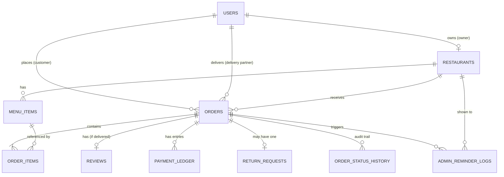

# CampusBite — End-to-End Implementation Plan

> Status: **Approved (v3)**. D2, D3, D5, D6 and D14 are all confirmed, including no-refund cancellation after the 1-minute window while the order is still PLACED. The phase-by-phase checklist is in [TODO.md](TODO.md).

---

## 1. Solution Overview

CampusBite is a restaurant ordering and delivery platform with three roles: **Customer**, **Restaurant Owner** and **Delivery Partner**.

```
┌────────────────────┐   REST/JSON + JWT   ┌──────────────────────────┐   SQLAlchemy   ┌──────────────┐
│ React SPA (Vite)   │ ──────────────────▶ │ FastAPI backend (Docker) │ ─────────────▶ │ PostgreSQL   │
│ - React Router     │ ◀────────────────── │ - Auth / RBAC            │                │ (Docker)     │
│ - Context + Hooks  │                     │ - Order state machine    │                └──────────────┘
│ - Axios            │                     │ - Middleware (log/time)  │   HTTPS        ┌──────────────┐
└────────────────────┘                     │ - Reminder worker        │ ─────────────▶ │ OpenAI API   │
   runs locally (npm)                      │ - AI insights service    │                └──────────────┘
                                           └──────────────────────────┘
                                              docker compose: backend + db
```

| Layer | Choice |
|---|---|
| Frontend | React 18 + Vite, JavaScript (ES6+), React Router DOM v6, Axios, Context API + Hooks, Tailwind CSS for responsive layout |
| Backend | Python 3.12, FastAPI, Pydantic v2, SQLAlchemy 2.0 (sync, psycopg 3), Alembic migrations |
| Auth | `bcrypt` password hashing, JWT (HS256) via `python-jose` / `PyJWT` |
| Database | PostgreSQL 16, running as a container in docker-compose |
| AI | OpenAI Python SDK (`gpt-4o-mini` by default, set by env var) |
| DevOps | Dockerfile (backend), docker-compose.yml (backend + postgres), `.env.example`, Git/GitHub |
| Testing | pytest + FastAPI TestClient (backend); Vitest + React Testing Library for a few key components (optional) |

---

## 2. Key Decisions & Assumptions (please review)

| # | Decision | Rationale / Alternative |
|---|---|---|
| D1 | **PostgreSQL in docker-compose** alongside the backend. | Meets "backend can connect to SQL DB" with one command. Alternative: SQLite (simpler but weaker as a "relational DB" demo). |
| D2 | ✅ **Confirmed: separate onboarding per role, Zomato/Swiggy style.** <br>• **Customer**: signs up from the main app (`/register`) and always gets the `customer` role. The role is never a client-supplied field. <br>• **Restaurant owner**: uses a separate **"Partner with us"** form (`/partner/register`) that collects owner details and restaurant details (name, address, cuisine, phone) and creates the owner and restaurant together. <br>• **Delivery partner**: uses a separate **"Ride with us"** form (`/delivery/register`) that collects personal details and vehicle details (vehicle type, vehicle number). <br>• **One shared login page** that redirects each user to their role's dashboard. <br>• Seeded demo accounts exist for every role. | This mirrors how Zomato and Swiggy keep separate customer, restaurant-partner and delivery-partner signups. Real platforms also run KYC and admin verification before activating partners. The PRD has no admin role, so partner accounts here are **active immediately**. |
| D3 | ✅ **Confirmed: one restaurant per owner** (`restaurants.owner_id` UNIQUE). | Keeps the owner dashboard simple. |
| D4 | **The cart lives on the client** (React Context + localStorage) and holds items from **one restaurant at a time**. The server recomputes all prices and availability at checkout. | No cart table needed, and the client is never trusted for prices. Adding an item from a different restaurant prompts the user to clear the cart. |
| D5 | ✅ **Confirmed: after delivery, refunds go through the return/refund flow.** A refund requires a `DELIVERED` order, a customer request with a reason, and owner approval. On approval, payment_status becomes `refunded`, a dummy REFUND ledger entry is written for the order amount, and the customer sees the refunded amount on their dashboard. **Cancelling after the 1-minute window (D14)** is still allowed while the order is PLACED, but it does not refund: the payment_status stays as it is, no ledger entry is written, and the order is excluded from revenue statistics. | Follows the PRD, plus D14. |
| D6 | ✅ **Confirmed: owners cannot reject or cancel orders.** Only the customer can cancel, and only while the order is PLACED. The owner's only action on a PLACED order is **Accept**, which is available only once the 1-minute window (D14) has ended. The owner's approve/reject power applies only to **return/refund requests**. | Not mentioned in the PRD, so not allowed. |
| D7 | **Return requests get their own table** with a UNIQUE `order_id`. | Enforces "one return request per order" at the DB level. When approved, the order becomes `REFUNDED`. |
| D8 | **Delivery partners form a global pool.** Any owner can assign any active partner, and the list shows each partner's current active-delivery count. | Simplest model that fits the PRD. |
| D9 | **Reminder worker = asyncio periodic task** started in the FastAPI lifespan (every 60s). FastAPI `BackgroundTasks` also triggers an on-demand scan when the owner opens the dashboard. | No extra infrastructure (no Celery or Redis). Limitation: it assumes a single backend replica, which is fine here. |
| D10 | **AI rate limiting is an in-memory per-user sliding window** (default 10 req/min), plus retry with exponential backoff on OpenAI 429s and timeouts. | Enough for a capstone. Redis would be needed for multiple instances. |
| D11 | **Currency is INR (₹) and timestamps are stored in UTC**. The frontend shows local time. | |
| D12 | **Menu items are soft-deleted** (`is_deleted`) so past orders still resolve. Order items also store a snapshot of the name and unit price. | Order history stays correct when the menu changes. |
| D13 | **Frontend runs locally with `npm run dev`** and is not containerised. | The PRD only requires Docker for the backend. A frontend service can be added if wanted. |
| D14 | ✅ **Requested: 1-minute free cancellation window.** <br>• After a successful order and payment, the customer sees a **60-second countdown** with a **"Cancel order"** button. <br>• Cancelling in that window **cancels the order at once and refunds the full amount automatically**. No reason is asked, no request goes to the restaurant owner, and the owner doesn't need to approve anything. <br>• Behind the scenes, order → `CANCELLED`, payment_status → `refunded`, and a dummy REFUND ledger entry is written with the note `free_cancellation_window`. <br>• **The owner cannot Accept the order during the window** (the backend returns 409), so the order stays PLACED and the cancel button can't stop working partway through the countdown. The owner sees the order marked "Awaiting customer confirmation · 0:42". <br>• **The server decides** using `cancellable_until = created_at + CANCEL_GRACE_SECONDS` (60 by default). The API returns `cancel_window_remaining_seconds`, so the countdown doesn't depend on the device clock being right. <br>• **After the window**, the button changes to "Cancel (no refund)" with a confirmation dialog, which follows D5 and is only available while the order is still PLACED. | Similar to Zomato's free 60-second cancellation. |

---

## 3. Repository Structure

```
campusbite/
├── README.md
├── PLAN.md
├── docker-compose.yml
├── .env.example                 # compose-level vars (postgres + backend)
├── .gitignore                   # .env, node_modules, __pycache__, venv, dist
│
├── backend/
│   ├── Dockerfile
│   ├── .dockerignore
│   ├── requirements.txt
│   ├── .env.example
│   ├── alembic.ini
│   ├── alembic/                 # migrations
│   ├── scripts/
│   │   ├── entrypoint.sh        # wait for db → alembic upgrade head → optional seed → uvicorn
│   │   └── seed.py              # demo users, restaurants, menus, historical orders
│   ├── app/
│   │   ├── main.py              # app factory, routers, middleware, lifespan (reminder worker)
│   │   ├── core/
│   │   │   ├── config.py        # pydantic-settings, reads env
│   │   │   ├── security.py      # bcrypt hash/verify, JWT encode/decode
│   │   │   └── logging.py
│   │   ├── db/
│   │   │   ├── base.py          # DeclarativeBase
│   │   │   └── session.py       # engine, SessionLocal, get_db dependency
│   │   ├── models/              # user, restaurant, menu_item, order, order_item, order_status_history,
│   │   │                        # review, payment_ledger, return_request, admin_reminder_log
│   │   ├── schemas/             # Pydantic request/response models + Page[T] generic
│   │   ├── api/
│   │   │   ├── deps.py          # get_current_user, require_roles(...)
│   │   │   └── v1/
│   │   │       ├── auth.py
│   │   │       ├── restaurants.py   # public browse + menu search
│   │   │       ├── orders.py        # customer: place, list, detail, cancel, review, return
│   │   │       ├── owner.py         # owner: restaurant, menu, orders, assign, stats, returns, reminders
│   │   │       ├── delivery.py      # delivery partner endpoints
│   │   │       └── ai.py            # AI insights
│   │   ├── services/
│   │   │   ├── order_state.py   # transition table + validate_transition()
│   │   │   ├── order_service.py
│   │   │   ├── payment_service.py
│   │   │   ├── return_service.py
│   │   │   ├── stats_service.py
│   │   │   ├── reminder_service.py
│   │   │   └── ai_service.py    # context builder + OpenAI client + rate limiter
│   │   ├── middleware/
│   │   │   └── request_logging.py
│   │   └── workers/
│   │       └── reminder_worker.py
│   └── tests/
│       ├── conftest.py
│       ├── test_auth.py
│       ├── test_rbac.py
│       ├── test_order_lifecycle.py
│       ├── test_returns.py
│       ├── test_reminders.py
│       └── test_ai.py           # OpenAI mocked
│
└── frontend/
    ├── package.json
    ├── vite.config.js
    ├── .env.example             # VITE_API_BASE_URL
    ├── index.html
    └── src/
        ├── main.jsx
        ├── App.jsx              # route table
        ├── api/                 # client.js (axios + interceptors), auth.js, restaurants.js, orders.js,
        │                        # owner.js, delivery.js, ai.js
        ├── context/             # AuthContext.jsx, CartContext.jsx
        ├── hooks/               # useApi.js, usePagination.js, useDebounce.js, useAuth.js, useCart.js
        ├── components/
        │   ├── layout/          # Navbar (role-aware), Footer, Layout
        │   ├── routing/         # ProtectedRoute, RoleRoute
        │   ├── common/          # Loader, ErrorMessage, EmptyState, Pagination, Modal, ConfirmDialog,
        │   │                    # StatusBadge, RatingStars, DateRangeFilter, StatusFilter
        │   ├── restaurant/      # RestaurantCard, DishCard, DishFilters
        │   ├── order/           # OrderCard, OrderTimeline, OrderItemsTable, ReviewForm, ReturnForm,
        │   │                    # CancelCountdown (60s free-cancel timer)
        │   └── owner/           # StatsCards, MenuItemForm, AssignPartnerModal, ReminderList
        ├── pages/
        │   ├── auth/            # LoginPage, CustomerRegisterPage, PartnerRegisterPage (restaurant),
        │   │                    # DeliveryRegisterPage
        │   ├── customer/        # RestaurantListPage, RestaurantMenuPage, CartPage, CheckoutPage,
        │   │                    # CustomerDashboardPage, OrderDetailPage, AIInsightsPage
        │   ├── owner/           # OwnerDashboardPage, MenuManagementPage, OrderManagementPage,
        │   │                    # ReturnRequestsPage
        │   ├── delivery/        # DeliveryDashboardPage, DeliveryHistoryPage
        │   └── NotFoundPage, UnauthorizedPage
        └── utils/               # formatCurrency, formatDate, constants (statuses, roles)
```

---

## 4. Database Design

### 4.1 ER Diagram



### 4.2 Tables

**users**
| Column | Type | Notes |
|---|---|---|
| id | PK int | |
| name | varchar(100) | |
| email | varchar(255) | UNIQUE, indexed, lowercase |
| phone | varchar(20) | |
| password_hash | varchar(255) | bcrypt |
| role | enum `customer` / `restaurant_owner` / `delivery_partner` | |
| default_address | text, nullable | customers |
| vehicle_type | enum `bicycle` / `scooter` / `bike`, nullable | delivery partners |
| vehicle_number | varchar(20), nullable | delivery partners |
| is_active | bool | default true |
| created_at, updated_at | timestamptz | |

**restaurants**
| Column | Type | Notes |
|---|---|---|
| id | PK | |
| owner_id | FK users.id | UNIQUE (D3) |
| name, description, cuisine, address, phone, image_url | | |
| is_open | bool | |
| created_at, updated_at | | |

**menu_items**
| Column | Type | Notes |
|---|---|---|
| id | PK | |
| restaurant_id | FK restaurants.id | indexed |
| name | varchar(150) | indexed (search) |
| description, category, image_url | | |
| price | numeric(10,2) | CHECK > 0 |
| is_veg | bool | |
| is_available | bool | default true |
| is_deleted | bool | soft delete (D12) |
| created_at, updated_at | | |

**orders**
| Column | Type | Notes |
|---|---|---|
| id | PK | |
| customer_id | FK users.id | indexed |
| restaurant_id | FK restaurants.id | |
| delivery_partner_id | FK users.id, nullable | indexed |
| status | enum OrderStatus | see §5 |
| payment_status | enum `pending` / `mock_paid` / `refunded` | |
| subtotal, delivery_fee, total_amount | numeric(10,2) | computed server-side |
| delivery_address, contact_phone, notes | | captured at checkout |
| status_updated_at | timestamptz | drives reminders |
| cancellable_until | timestamptz | `created_at + CANCEL_GRACE_SECONDS`, the end of the free cancellation window (D14) |
| cancelled_at | timestamptz, nullable | |
| created_at, updated_at | | |
| Indexes | | `(restaurant_id, status, created_at)`, `(customer_id, created_at)`, `(delivery_partner_id, status)` |

**order_items**: id, order_id FK, menu_item_id FK, item_name (snapshot), unit_price (snapshot), quantity (CHECK 1–20), line_total.

**order_status_history**: id, order_id FK, from_status, to_status, changed_by_user_id FK, changed_at. Used for the order timeline on the frontend and as an audit trail.

**reviews**: id, order_id FK UNIQUE, customer_id FK, restaurant_id FK, rating (CHECK 1–5), comment, created_at.

**payment_ledger**
| Column | Type | Notes |
|---|---|---|
| id | PK | |
| order_id | FK orders.id | many entries per order |
| entry_type | enum `charge` / `refund` | |
| amount | numeric(10,2) | |
| status | enum `success` / `failed` | |
| method | varchar | `"dummy"` |
| transaction_ref | varchar | e.g. `MOCK-<uuid>` |
| note | varchar, nullable | e.g. `free_cancellation_window` or `return_approved` |
| created_at | | |

**return_requests**: id, order_id FK UNIQUE, customer_id FK, reason (text, required, 10–500 chars), status (`requested` / `approved` / `rejected`), owner_note, created_at, resolved_at, resolved_by FK.

**admin_reminder_logs**: id, order_id FK, restaurant_id FK, order_status_at_reminder, message, minutes_pending, is_resolved (bool), created_at, resolved_at. Deduplication: there is at most one unresolved reminder per `(order_id, order_status_at_reminder)`.

---

## 5. Order Lifecycle (State Machine)

```mermaid
stateDiagram-v2
    [*] --> PLACED: customer checkout (payment = mock_paid)
    PLACED --> ACCEPTED: owner
    PLACED --> CANCELLED: customer only (within 60s → auto full refund; after → no refund)
    ACCEPTED --> PREPARING: owner
    PREPARING --> READY: owner
    READY --> ASSIGNED: owner assigns delivery partner
    ASSIGNED --> OUT_FOR_DELIVERY: assigned partner
    OUT_FOR_DELIVERY --> DELIVERED: assigned partner
    DELIVERED --> REFUNDED: owner approves return
    CANCELLED --> [*]
    REFUNDED --> [*]
```



All transitions live in a single table in `services/order_state.py`:

```python
TRANSITIONS = {
    (PLACED,           ACCEPTED):         {Role.RESTAURANT_OWNER},
    (PLACED,           CANCELLED):        {Role.CUSTOMER},           # refund if now <= cancellable_until
    # PLACED -> ACCEPTED is also blocked (409) while now <= cancellable_until (D14)
    (ACCEPTED,         PREPARING):        {Role.RESTAURANT_OWNER},
    (PREPARING,        READY):            {Role.RESTAURANT_OWNER},
    (READY,            ASSIGNED):         {Role.RESTAURANT_OWNER},   # only via /assign
    (ASSIGNED,         OUT_FOR_DELIVERY): {Role.DELIVERY_PARTNER},
    (OUT_FOR_DELIVERY, DELIVERED):        {Role.DELIVERY_PARTNER},
    (DELIVERED,        REFUNDED):         {Role.RESTAURANT_OWNER},   # only via return approval
}
```

**Enforcement, in order:**
1. **Authentication**: a valid JWT whose user exists and is active (otherwise 401).
2. **Role**: the endpoint's `require_roles(...)` check (otherwise 403).
3. **Ownership**: the customer owns the order, the owner owns the order's restaurant, or the partner is the assigned `delivery_partner_id` (otherwise 404, so the order's existence isn't revealed).
4. **Transition validity**: the `(current, target)` pair is in `TRANSITIONS` and the actor's role is allowed (otherwise **409 Conflict** with a message such as `"Cannot move order from DELIVERED to CANCELLED"`).
5. **Time rules (D14)**: during the free cancellation window, the owner's Accept gets 409 "Order is in the customer's free-cancellation window". A customer cancel inside the window refunds, and one after it doesn't.
6. **Concurrency**: the order row is loaded with `SELECT … FOR UPDATE` inside the transaction, so two simultaneous updates can't both succeed.
7. **Side effects in the same transaction**: write `order_status_history`, update `status_updated_at`, resolve open reminders for the order, and write a REFUND ledger entry when a return is approved or the customer cancels inside the free window.

---

## 6. Authentication & Authorization

- **Registration uses three endpoints (D2)**, and each one sets the role on the server:
  - `POST /auth/register` → `customer`
  - `POST /auth/register/restaurant-owner` → `restaurant_owner`, creating the user and restaurant in one transaction
  - `POST /auth/register/delivery-partner` → `delivery_partner`

  All three check for a unique email and a password of at least 8 characters, then hash the password with `bcrypt.hashpw` (the `bcrypt` library is used directly, avoiding passlib's incompatibility with bcrypt 4.x).
- **Login** `POST /auth/login` returns `{access_token, token_type: "bearer", user: {id, name, email, role}}`.
- **JWT payload**: `sub` (user id), `role`, `exp` (60 min by default, set by env var). The secret comes from `JWT_SECRET_KEY` in the environment.
- **`get_current_user`** decodes the token and **re-loads the user from the DB** on each request. The role always comes from the DB, never from client input.
- **`require_roles(*roles)`** is a dependency factory applied at router level:
  - `/owner/*` → `restaurant_owner`
  - `/delivery/*` → `delivery_partner`
  - `/orders/*` (customer actions), `/ai/*` → `customer`
- **Data scoping**: every query filters by the caller's identity (`customer_id = me`, `restaurant.owner_id = me`, `delivery_partner_id = me`). IDs taken from the request body are never trusted for scoping.
- **Frontend**: the token and user are stored in `localStorage`. An Axios request interceptor adds `Authorization: Bearer <token>`, and a response interceptor clears auth and redirects to `/login` on a 401. `ProtectedRoute` and `RoleRoute` guard pages, and the Navbar shows only links for the user's role. The backend still enforces everything.

---

## 7. API Design

Base path: `/api/v1`. All list endpoints are paginated with `?page=1&page_size=10` (max 50) and return:

```json
{ "items": [...], "total": 42, "page": 1, "page_size": 10, "pages": 5 }
```

Error format: `{"detail": "message"}` (FastAPI's default), using status codes 400, 401, 403, 404, 409, 422, 429 and 503 as appropriate. Interactive documentation is generated automatically at **`/docs`** (Swagger) and **`/redoc`**.

### 7.1 Auth
| Method | Path | Role | Description |
|---|---|---|---|
| POST | `/auth/register` | public | Customer signup: `{name, email, phone, password, default_address?}` |
| POST | `/auth/register/restaurant-owner` | public | "Partner with us": owner details plus `restaurant: {name, address, cuisine, phone, description?}` |
| POST | `/auth/register/delivery-partner` | public | "Ride with us": personal details plus `{vehicle_type, vehicle_number}` |
| POST | `/auth/login` | public | Shared login for all roles. Returns a JWT and user info (including role). |
| GET | `/auth/me` | any | Current user profile |

### 7.2 Restaurants & Menu (browse)
| Method | Path | Role | Description |
|---|---|---|---|
| GET | `/restaurants?search=&cuisine=&page=` | public | List restaurants, each with an average rating |
| GET | `/restaurants/{id}` | public | Restaurant details |
| GET | `/restaurants/{id}/menu?search=&min_price=&max_price=&category=&veg=&sort=price_asc&page=` | public | Search and filter dishes by name and price. Only available, non-deleted items are returned. |
| GET | `/menu-items/{id}` | public | Dish details |
| GET | `/restaurants/{id}/reviews?page=` | public | Reviews for the restaurant |

### 7.3 Customer Orders
| Method | Path | Role | Description |
|---|---|---|---|
| POST | `/orders` | customer | Place an order: `{restaurant_id, items:[{menu_item_id, quantity}], delivery_address, contact_phone, notes}`. The server validates items (same restaurant, available), computes totals, creates the order (PLACED), sets payment to `mock_paid`, writes a CHARGE ledger entry and sets `cancellable_until`, all in one transaction. Returns 201 with `cancellable_until` and `cancel_window_remaining_seconds`. |
| GET | `/orders/me?status=&date_from=&date_to=&page=` | customer | Order history with filters |
| GET | `/orders/{id}` | customer / owner / partner (scoped) | Order details, items, timeline, payment, return and review status |
| POST | `/orders/{id}/cancel` | customer | No request body and no reason. Allowed only in PLACED, otherwise 409. **Within the 60s window**: the order is cancelled and refunded automatically, with no owner involvement (D14). **After the window**: the order is cancelled with no refund (D5). The response includes `{status, payment_status, refunded_amount}`. |
| POST | `/orders/{id}/review` | customer | `{rating, comment}`. Only for DELIVERED orders, one per order (409 if one exists). |
| POST | `/orders/{id}/return` | customer | `{reason}`. Only for DELIVERED orders, one per order (409 if one exists). |

### 7.4 Restaurant Owner
| Method | Path | Description |
|---|---|---|
| GET / PUT | `/owner/restaurant` | View or update own restaurant profile |
| GET | `/owner/menu-items?search=&available=&page=` | All own dishes, including unavailable ones |
| POST | `/owner/menu-items` | Add a dish |
| PUT | `/owner/menu-items/{id}` | Update a dish |
| PATCH | `/owner/menu-items/{id}/availability` | `{is_available}` toggle |
| DELETE | `/owner/menu-items/{id}` | Soft delete |
| GET | `/owner/orders?status=&date_from=&date_to=&page=` | Incoming orders with filters |
| PATCH | `/owner/orders/{id}/status` | `{status}`: ACCEPTED, PREPARING or READY only. Any other status gets 409, including CANCELLED (owners cannot cancel or reject, D6). ACCEPTED also gets 409 while the order is still in the 60s free cancellation window (D14). |
| GET | `/owner/delivery-partners` | Active partners with their current load |
| POST | `/owner/orders/{id}/assign` | `{delivery_partner_id}`. Order must be READY, and it moves to ASSIGNED. |
| GET | `/owner/stats?date_from=&date_to=` | Statistics (see below) |
| GET | `/owner/returns?status=&page=` | Return/refund requests |
| POST | `/owner/returns/{id}/approve` | Return → approved, order → REFUNDED, payment → `refunded`, REFUND ledger entry written |
| POST | `/owner/returns/{id}/reject` | `{owner_note}`. Return → rejected; the order stays DELIVERED. |
| GET | `/owner/reminders?resolved=false&page=` | Reminders for stale orders |
| PATCH | `/owner/reminders/{id}/acknowledge` | Dismiss a reminder |

**Stats payload:** total orders, orders today, count by status, gross revenue (charges on non-cancelled orders), refunds total, net revenue, average order value, average rating and review count, top 5 dishes by quantity, pending return count, and open reminder count.

### 7.5 Delivery Partner
| Method | Path | Description |
|---|---|---|
| GET | `/delivery/orders?status=&page=` | Assigned active orders (ASSIGNED, OUT_FOR_DELIVERY) |
| GET | `/delivery/orders/{id}` | Details, including customer name, phone, address and items. Only for orders assigned to the caller. |
| PATCH | `/delivery/orders/{id}/status` | `{status}`: OUT_FOR_DELIVERY or DELIVERED |
| GET | `/delivery/history?date_from=&date_to=&page=` | Delivered orders |

### 7.6 AI & System
| Method | Path | Role | Description |
|---|---|---|---|
| POST | `/ai/insights` | customer | `{question?: string}`. With no question, it returns a summary of recent orders. |
| GET | `/health` | public | Liveness check plus DB ping |

---

## 8. Dummy Payment & Return/Refund Flows

**Checkout (one DB transaction):**
1. Validate the cart: all items belong to `restaurant_id`, are available and not deleted, and the restaurant is open.
2. Compute `subtotal`, `delivery_fee` (a flat amount, e.g. ₹30) and `total` from DB prices.
3. Insert the order (PLACED, payment `pending`) and its order_items (with snapshots).
4. `payment_service.mock_charge(order)` inserts a ledger entry `charge/success/MOCK-<uuid>` and sets payment_status = `mock_paid`.
5. Set `cancellable_until = created_at + 60s`, commit, and return the order. The frontend shows a "Payment successful (demo)" confirmation with the **60-second free cancellation countdown** (D14).

The checkout UI shows a dummy card form (pre-filled test number, no validation against any gateway) so the flow looks realistic. The card data is **never sent** to the backend.

**Cancellation**: the customer can cancel only while the order is PLACED.
- **Within 60 seconds of placing (D14)**: a single click cancels the order with no reason and no owner involvement. In one transaction, the order becomes `CANCELLED`, a ledger entry `refund/success` is written for the full amount (`MOCK-REFUND-<uuid>`, note `free_cancellation_window`), and payment_status becomes `refunded`. The customer sees "Order cancelled · ₹X refunded (demo)".
- **After 60 seconds, still PLACED (D5)**: the order becomes `CANCELLED` after a confirmation dialog. The payment_status is left unchanged, no refund entry is written, and the order is excluded from revenue statistics.

**Return/refund (for delivered orders):**
- Customer: `POST /orders/{id}/return` with a reason. This is rejected unless the order is `DELIVERED` and has no existing return request (UNIQUE constraint as a backstop, mapped to 409).
- Owner approves: return → `approved`, ledger entry `refund/success` for the full amount (`MOCK-REFUND-<uuid>`), payment_status → `refunded`, order → `REFUNDED`. The customer's order detail shows "₹X refunded (demo)" with the refund reference and date.
- Owner rejects: return → `rejected` with an owner_note. The payment and order are unchanged.
- The customer dashboard shows payment status and return status badges on every order.

---

## 9. AI Order Insights

**Flow:**
1. The customer opens **AI Insights**, picks a suggested question or types one (max 500 characters).
2. The frontend calls `POST /ai/insights` with the JWT.
3. The backend takes `customer_id` **only from the JWT** and loads that customer's orders (latest 50, with items and restaurant names).
4. The backend **computes aggregates in Python** first, so the model does not have to do arithmetic:
   - spend this week, this month and all-time (net of refunds)
   - order count by status and a list of undelivered orders
   - top 5 most frequently ordered items
   - the last 5 orders in detail
5. It builds a compact JSON context and calls OpenAI with:
   - **System prompt**: "You are CampusBite's order assistant. Answer ONLY using the provided order data for this customer. Today is {date}. Currency is INR. If the question is unrelated to their orders or the data is insufficient, say so. Never invent orders."
   - **User message**: the question (or a default "Summarize my recent orders and notable patterns") plus the context JSON.
   - `temperature=0.3`, `max_tokens≈500`, `timeout=20s`.
6. The response returned is `{answer, generated_at, orders_considered}`, and the frontend renders it in a chat-style panel.

**Isolation:** the model only ever receives the authenticated customer's data, so no prompt can reach another customer's orders because that data never enters the prompt. A test asserts that the context builder output contains only the caller's order IDs.

**Error and rate-limit handling:**
- A per-user sliding window (`AI_RATE_LIMIT_PER_MINUTE`, default 10) returns **429** with a `Retry-After` header.
- OpenAI `RateLimitError`, `APITimeoutError` and `APIConnectionError` are retried up to 2 times with exponential backoff (1s, 2s), then return **503** with "AI service is busy, please try again shortly."
- A missing `OPENAI_API_KEY` returns **503** "AI insights are not configured." The rest of the app works normally.
- A customer with no orders gets a friendly message and no OpenAI call is made, saving cost.
- The API key is read only from the backend environment. It never reaches the frontend and is never logged.

---

## 10. Middleware & Background Tasks

**Middleware (`middleware/request_logging.py`):**
- Generates or propagates an `X-Request-ID`.
- Logs `method path status duration_ms request_id` for every request. Bodies and auth headers are never logged.
- Adds an `X-Process-Time` response header.
- Catches unhandled exceptions, logs the stack trace with the request ID, and returns a clean 500 JSON response.
- `CORSMiddleware` is configured from `CORS_ORIGINS` (e.g. `http://localhost:5173`).

**Reminder background task:**
- `workers/reminder_worker.py` is an `asyncio` loop started in the FastAPI `lifespan` and cancelled on shutdown. It runs every `REMINDER_CHECK_INTERVAL_SECONDS` (60s by default).
- `reminder_service.scan()`:
  - finds orders with `status IN (PLACED, ACCEPTED)` and `status_updated_at < now() - REMINDER_THRESHOLD_MINUTES` (15 by default), skipping orders still inside the 60s free cancellation window
  - inserts an `admin_reminder_logs` row if there is no unresolved reminder for the same `(order_id, status)`, with a message like *"Order #123 has been PLACED for 22 minutes without an update."*
- The scan runs in a threadpool so it doesn't block the event loop.
- When an order's status changes, its open reminders are marked resolved.
- `GET /owner/reminders` also schedules a scan via FastAPI `BackgroundTasks`, so the list stays fresh.
- The owner dashboard shows a reminder banner and list with "Acknowledge" buttons. The frontend polls this endpoint every 60s while the dashboard is open (no WebSockets, as allowed).

---

## 11. Frontend Design

### 11.1 State Management
- **AuthContext**: `user`, `token`, `login()`, `logout()`, `register()`, `isAuthenticated`, `hasRole()`. It initialises from localStorage and validates the session with `/auth/me` on load.
- **CartContext**: `items`, `restaurant`, `addItem`, `updateQty`, `removeItem`, `clearCart`, `subtotal`, `itemCount`. It persists to localStorage and enforces a single restaurant (D4).
- **Custom hooks**: `useApi(fn, deps)` returns `{data, loading, error, refetch}`; `usePagination` manages page state; `useDebounce` delays search input.

### 11.2 Routes
| Path | Page | Access |
|---|---|---|
| `/login` | Shared login for all roles | public (redirects to the role's home if already logged in) |
| `/register` | Customer signup | public |
| `/partner/register` | "Partner with us": restaurant owner and restaurant signup (linked from the footer and login page) | public |
| `/delivery/register` | "Ride with us": delivery partner signup (linked from the footer and login page) | public |
| `/` | Restaurant listing (search, cuisine filter, pagination) | public / customer |
| `/restaurants/:id` | Restaurant menu: dish search, price range filter, veg filter, sort, add to cart | public / customer |
| `/cart` | Cart: update quantities, remove items | customer |
| `/checkout` | Address, phone, dummy payment, place order. Then redirects to the order page showing the 60s free-cancel countdown. | customer |
| `/customer/dashboard` | Orders (current/past tabs) with status and date filters, payment and return badges, cancel / review / return actions, pagination | customer |
| `/orders/:id` | Order detail with status timeline. For the customer, it also shows `CancelCountdown` ("Cancel for free · 0:42") while the window is open. | customer / owner / partner (scoped) |
| `/customer/ai-insights` | Suggested question chips, free-text question, answer panel, loading and error states | customer |
| `/owner/dashboard` | Stats cards, reminders panel, recent orders | owner |
| `/owner/menu` | Menu management: table, add/edit modal, availability toggle, delete | owner |
| `/owner/orders` | Order management: status and date filters, next-step action buttons, assign-partner modal | owner |
| `/owner/returns` | Return requests: approve or reject with a note | owner |
| `/delivery/dashboard` | Assigned deliveries with status filter, customer details, "Out for Delivery" and "Delivered" buttons | partner |
| `/delivery/history` | Delivered orders, paginated | partner |
| `/unauthorized`, `*` | 403 / 404 pages | |

After login, users are redirected by role: customer → `/`, owner → `/owner/dashboard`, partner → `/delivery/dashboard`.

### 11.3 UX Standards
- Every data view has **loading**, **error** (with retry) and **empty** states.
- Action buttons show only valid next steps. For example, the owner sees "Accept" on PLACED orders and "Start Preparing" on ACCEPTED orders, and the customer sees "Cancel" only on PLACED orders. Buttons are disabled while a request is in flight.
- **`CancelCountdown` component (D14):**
  - It starts from the server's `cancel_window_remaining_seconds` and ticks down each second with `setInterval` inside `useEffect`, which is cleared when the component unmounts.
  - While time remains, it shows **"Cancel for free · 0:42"**. One click cancels the order (there is no reason form), then the page shows a refund confirmation.
  - At 0 it switches to "Cancel (no refund)", which asks for confirmation first, and refetches the order.
  - On the owner side, Accept stays disabled and shows "Awaiting customer confirmation · 0:42" until the window ends.
- Toasts confirm success and show backend `detail` messages on failure.
- The layout is responsive with Tailwind breakpoints: card grids collapse to one column on mobile, tables become stacked cards, and the navbar becomes a hamburger menu.
- Forms are validated on the client (required fields, rating 1–5, return reason length) and the server validates again.

---

## 12. Dockerization

**`backend/Dockerfile`** (summary):
```dockerfile
FROM python:3.12-slim
ENV PYTHONDONTWRITEBYTECODE=1 PYTHONUNBUFFERED=1
WORKDIR /app
COPY requirements.txt .
RUN pip install --no-cache-dir -r requirements.txt
COPY . .
RUN useradd -m appuser && chmod +x scripts/entrypoint.sh
USER appuser
EXPOSE 8000
ENTRYPOINT ["./scripts/entrypoint.sh"]   # alembic upgrade head → seed if SEED_DEMO_DATA=true → uvicorn app.main:app --host 0.0.0.0 --port 8000
```

**`docker-compose.yml`** (summary):
```yaml
services:
  db:
    image: postgres:16-alpine
    env_file: .env
    volumes: [pgdata:/var/lib/postgresql/data]
    ports: ["5432:5432"]
    healthcheck: { test: ["CMD-SHELL", "pg_isready -U $${POSTGRES_USER}"], interval: 5s, retries: 10 }
  backend:
    build: ./backend
    env_file: .env
    environment:
      DATABASE_URL: postgresql+psycopg://${POSTGRES_USER}:${POSTGRES_PASSWORD}@db:5432/${POSTGRES_DB}
    ports: ["8000:8000"]
    depends_on: { db: { condition: service_healthy } }
volumes: { pgdata: {} }
```

- `.dockerignore` excludes `.env`, `venv`, `__pycache__`, `tests` and `.git`, so no secrets end up in the image.
- `.env` is git-ignored. `.env.example` is committed with placeholder values only.

**Environment variables (`.env.example`):**
```
# Database
POSTGRES_USER=campusbite
POSTGRES_PASSWORD=change_me
POSTGRES_DB=campusbite
DATABASE_URL=postgresql+psycopg://campusbite:change_me@db:5432/campusbite

# Auth
JWT_SECRET_KEY=replace_with_long_random_string
JWT_ALGORITHM=HS256
ACCESS_TOKEN_EXPIRE_MINUTES=60

# OpenAI
OPENAI_API_KEY=
OPENAI_MODEL=gpt-4o-mini
AI_RATE_LIMIT_PER_MINUTE=10

# Reminders
REMINDER_THRESHOLD_MINUTES=15
REMINDER_CHECK_INTERVAL_SECONDS=60

# Orders
CANCEL_GRACE_SECONDS=60
DELIVERY_FEE=30

# App
CORS_ORIGINS=http://localhost:5173
SEED_DEMO_DATA=true
LOG_LEVEL=INFO
```
Frontend `frontend/.env.example`: `VITE_API_BASE_URL=http://localhost:8000/api/v1`

---

## 13. Seed Data (for demo and evaluation)

- **Owners (3)**, each with a restaurant: e.g. "Campus Curry House" (North Indian), "Byte Pizza" (Italian), "Green Bowl" (Healthy). Each restaurant has 8–12 dishes across categories, with a few marked unavailable.
- **Delivery partners (2)** and **customers (2)**.
- **Historical orders** for customer 1 covering all statuses, including DELIVERED with a review, one return request pending, one REFUNDED, one CANCELLED, and a few stale PLACED orders that trigger reminders. This makes the AI insights and dashboards meaningful immediately.
- The demo credentials are listed in the README as **demo-only** accounts in the local seed. They are not secrets.

---

## 14. Testing Strategy

**Backend (pytest, isolated test DB):**
- **Auth**: each of the 3 register endpoints assigns the correct role; a `role` field injected into the customer register body is ignored; duplicate email is rejected; login success and failure; expired or invalid token returns 401; password stored hashed.
- **RBAC**:
  - customer calling `/owner/*` gets 403
  - partner reading an unassigned order gets 404
  - owner A updating owner B's order gets 404
  - customer A reading customer B's order gets 404
- **State machine**: every valid transition succeeds, and every invalid one gets 409 (e.g. PLACED→READY, DELIVERED→CANCELLED, customer cancelling an ACCEPTED order, owner trying to set CANCELLED). Assignment works only from READY.
- **Payments**: checkout writes a charge entry and sets `mock_paid`; an approved return writes a refund entry and sets `refunded`. Prices come from the DB even when the client sends a tampered price.
- **Free cancellation window (D14)**, with a frozen clock (e.g. `freezegun`):
  - a cancel at 30s refunds and writes a refund entry
  - a cancel at 61s doesn't refund and writes no ledger entry
  - an owner Accept at 30s gets 409, and at 61s succeeds
  - a cancel after Accept gets 409
  - a double cancel creates exactly one refund entry
- **Returns**: only for DELIVERED orders, a second request gets 409, a reason is required, approve and reject have the correct effects.
- **Reviews**: only for DELIVERED orders, one per order, rating bounds enforced.
- **Reminders**: a stale PLACED/ACCEPTED order creates one reminder (no duplicates on rescan), and a status change resolves it.
- **AI** (OpenAI mocked): the context holds only the caller's orders, the rate limit returns 429, OpenAI errors return 503, and a missing key returns 503.

**Frontend:** Vitest tests for `CartContext` logic, `ProtectedRoute` and `RoleRoute`. A manual end-to-end checklist in the README walks through the full lifecycle across three browser sessions, one per role.

---

## 15. README Contents

1. Project overview and screenshots
2. Tech stack
3. Features by role (checklist mapped to the PRD)
4. Architecture diagram and folder structure
5. **Backend via Docker Compose**: `cp .env.example .env`, edit secrets, `docker compose up --build`. The API runs at `http://localhost:8000` and the docs at `/docs`.
6. **Frontend locally**: `cd frontend && cp .env.example .env && npm install && npm run dev`, then open `http://localhost:5173`.
7. Environment variables table
8. Database setup: automatic migrations on container start, seeding, a reset command (`docker compose down -v`), and running Alembic manually
9. API documentation: Swagger/ReDoc links plus an endpoint summary table
10. Order lifecycle diagram and business rules
11. Demo accounts
12. Running tests
13. Security notes: secrets handling and RBAC approach

---

## 16. Implementation Phases

| Phase | Scope | Output |
|---|---|---|
| **P0 Setup** | Repo, .gitignore, backend skeleton, config, DB session, Alembic, Dockerfile, compose, `/health`, middleware | `docker compose up` gives a healthy API |
| **P1 Auth & models** | All models and migration, bcrypt, JWT, register/login/me, `require_roles` | Auth tests pass |
| **P2 Catalog** | Restaurant browse, menu search/filter, owner menu CRUD and availability | Menu endpoints |
| **P3 Orders core** | Checkout + dummy payment, state machine, customer list/detail/cancel, owner status updates, assignment, delivery partner endpoints | Lifecycle tests pass |
| **P4 Post-delivery** | Reviews, returns/refunds, ledger | Return tests pass |
| **P5 Owner extras** | Stats, reminder worker and endpoints | Reminder tests pass |
| **P6 AI** | AI service, rate limiting, error handling | AI tests pass (mocked) |
| **P7 Frontend foundation** | Vite, Tailwind, router, Auth and Cart contexts, Axios client, layout, protected routes, login/register | Users can log in by role |
| **P8 Customer UI** | Listing, menu, cart, checkout, dashboard, order detail, review/return, AI page | Customer flow end to end |
| **P9 Owner & Partner UI** | Owner dashboard, menu management, orders, returns, reminders; partner dashboard and history | All roles end to end |
| **P10 Polish & docs** | Seed data, responsive QA, error states, README, secret scan, final run on a clean clone | Ready to submit |

Git workflow: a `main` branch with feature branches per phase, small commits with conventional messages, and a check before each push that `.env` and keys are not committed (`git status`, plus `git grep -i "sk-"` before publishing).

---

## 17. Requirement Traceability

| PRD Section | Covered in |
|---|---|
| 1. Tech stack | §1, §3, §12 |
| 2A. Customer features | §7.2, §7.3, §8, §9, §11.2 |
| 2B. Owner features | §7.4, §10, §11.2 |
| 2C. Delivery partner features | §7.5, §11.2 |
| 3. Auth & RBAC | §6, §5 (enforcement) |
| 4. Order lifecycle & rules | §5 |
| 5. Dummy payment & refunds | §8, §4.2 (payment_ledger, return_requests) |
| 6. Dashboards, filtering, pagination | §7 (filters, paging), §11.2 |
| 7. AI insights | §9 |
| 8. Middleware & background tasks | §10 |
| 9. React requirements | §11 |
| 10. Database tables & relationships | §4 |
| 11. Dockerization | §12 |
| 12. API development | §7 |
| 13. Deployment & docs | §15, §16 (P10) |

---

## 18. Risks & Mitigations

| Risk | Mitigation |
|---|---|
| Secrets committed by accident | `.gitignore`, `.dockerignore`, `.env.example` only, pre-push grep check |
| OpenAI cost or quota exhausted during evaluation | Small model, capped tokens, per-user rate limit, graceful 503 so the app still works without a key |
| Race conditions on status updates | Row lock (`FOR UPDATE`) and transition check inside one transaction |
| Reminder worker runs once per replica | Documented single-replica assumption, plus DB-level deduplication |
| Frontend/backend contract drift | Pydantic response models; Swagger as the source of truth; a shared constants file for statuses on the frontend |
