# CampusBite 🍛

A full-stack restaurant ordering and delivery platform for a university campus. **Customers** browse restaurants, order food with a dummy payment and track delivery. **Restaurant owners** manage their menu, orders and refunds. **Delivery partners** handle the orders assigned to them. Customers can also ask an **AI assistant** about their own order history.

| | |
|---|---|
| **Frontend** | React 18 (Vite), JavaScript ES6+, React Router 6, Axios, Context API + Hooks, Tailwind CSS |
| **Backend** | Python 3.12, FastAPI, Pydantic v2, SQLAlchemy 2.0 ORM, Alembic, JWT (PyJWT), bcrypt |
| **Database** | PostgreSQL 16 (SQLite in-memory for tests) |
| **AI** | OpenAI API (`gpt-4o-mini` by default) |
| **DevOps** | Docker and Docker Compose (backend + database), `.env.example` files |
| **Tests** | pytest (228 backend tests), Vitest + Testing Library (58 frontend tests + a live end-to-end UI suite), Playwright UI suite (175 cases, see [doc/UI_TEST_REPORT.md](doc/UI_TEST_REPORT.md)) |

---

## Contents
1. [Features](#features)
2. [Screenshots](#screenshots)
3. [Architecture](#architecture)
4. [Quick start](#quick-start)
5. [Environment variables](#environment-variables)
6. [Database setup](#database-setup)
7. [Demo accounts](#demo-accounts)
8. [API documentation](#api-documentation)
9. [Order lifecycle and business rules](#order-lifecycle-and-business-rules)
10. [Running tests](#running-tests)
11. [Security](#security)
12. [Project structure](#project-structure)
13. [Known limitations](#known-limitations)

---

## Features

### Customer
- **Accounts:** sign up and log in, with a separate onboarding page for each role, as Zomato and Swiggy do.
- **Browsing:**
  - browse restaurants with ratings, and search by name or cuisine
  - view menus and search and filter dishes by **name, price range**, category and veg/non-veg, sorted by price or name
- **Cart:** add, update and remove dishes, one restaurant at a time.
- **Checkout:** place the order with a **dummy payment**. The order is marked `mock_paid` and a payment record is written.
- **1-minute free cancellation:** a countdown appears after ordering. Cancelling within it gives a **full automatic refund**, with no reason needed and no restaurant approval.
- **Order history:**
  - current and past tabs, filtered by **status and date**
  - payment and return/refund status badges
  - live tracking with a status timeline
- **After delivery:**
  - **rate and review** the order
  - **request a return or refund**, with a reason
- **AI order insights:** a summary of past orders, or answers to questions such as "How much did I spend this week?"

### Restaurant owner
- **Signup:** "Partner with us" creates the owner account and the restaurant together.
- **Restaurant profile:** edit the restaurant name, cuisine, address, phone, description, and photo from the owner dashboard.
- **Restaurant photos:** use an image URL or upload a JPEG, PNG, or WebP image (up to 5 MB). Drag to position the crop used on restaurant listings; uploaded images are saved in persistent storage.
- **Menu:** add, edit and delete dishes, and toggle **available/unavailable** for each one.
- **Orders:**
  - incoming orders filtered by **status and date**
  - Accept → Start preparing → Mark ready
  - **assign a delivery partner** from a list showing each partner's current number of deliveries
- **Statistics:** orders, revenue, refunds, average order value, rating, top dishes and pending returns.
- **Returns:** approve a request (refunds the payment and records the refund) or reject it (a note is required).
- **Reminders:** orders not updated for more than **15 minutes** are flagged on the dashboard. A background task creates them.
- **Open/closed:** a switch to stop new orders.

### Delivery partner
- **Signup:** "Ride with us", with vehicle details.
- **Deliveries:**
  - sees **only the orders assigned to them**, with the customer's name, phone and address
  - marks **Out for delivery**, then **Delivered**, confirming each step
  - delivery history with a date filter

### Platform
- **Login and roles:** JWT authentication. Every API endpoint checks the user's role on the server, and users can only see or change their own data.
- **Request logging:** middleware logs each request's method, path, status and response time, and adds `X-Request-ID` and `X-Process-Time` headers.
- **Large lists:** paginated everywhere.
- **Responsive:** the UI works on desktop and mobile. Tables become cards on small screens and the menu collapses behind a hamburger button.

---

## Screenshots

### Customer
| | |
|---|---|
| 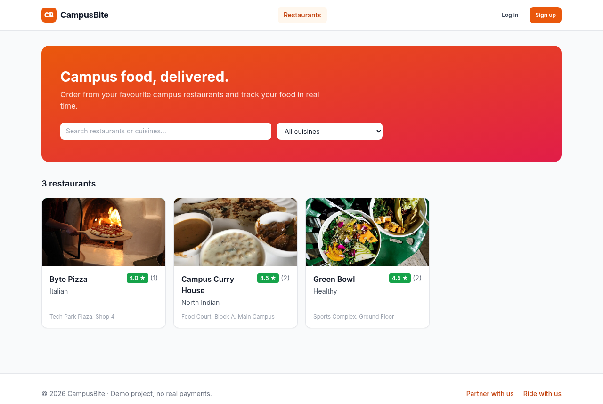<br>**Browse restaurants** — search, cuisine filter, ratings | 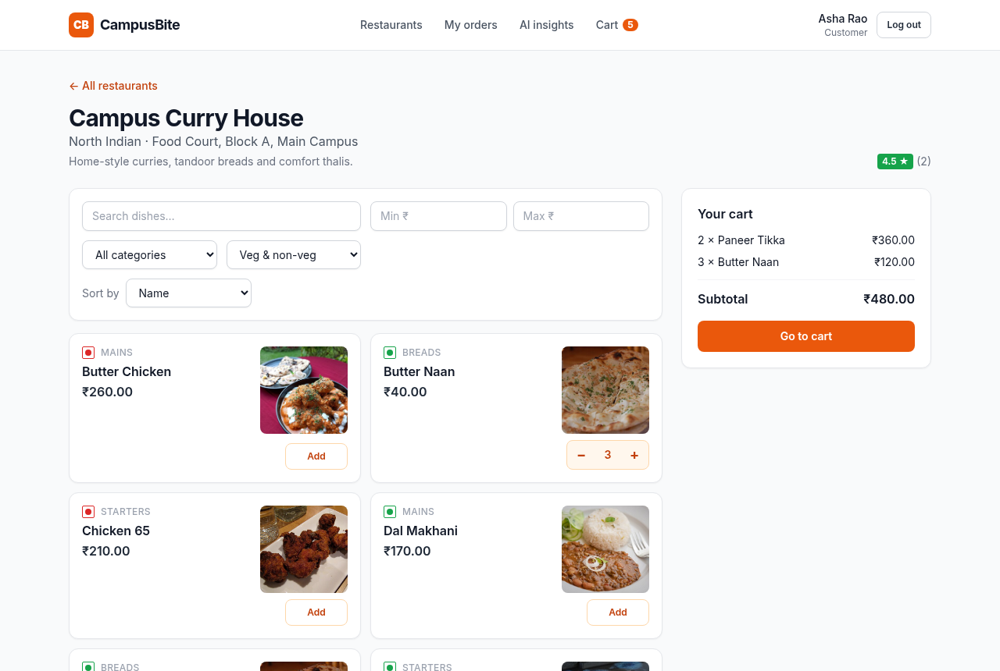<br>**Menu** — dish photos, search/price/category/veg filters, live cart |
| 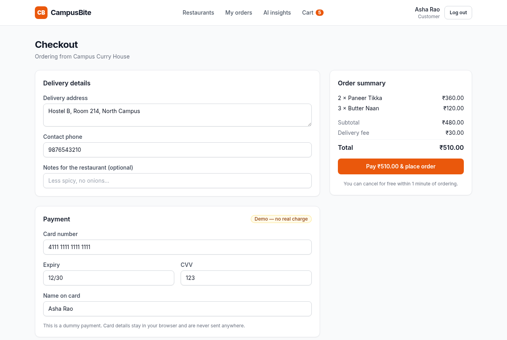<br>**Checkout** — delivery details and dummy payment | 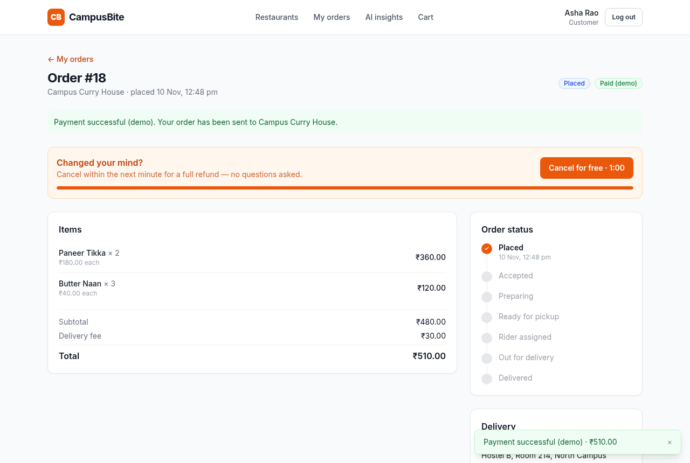<br>**60-second free cancellation** — full automatic refund |
| 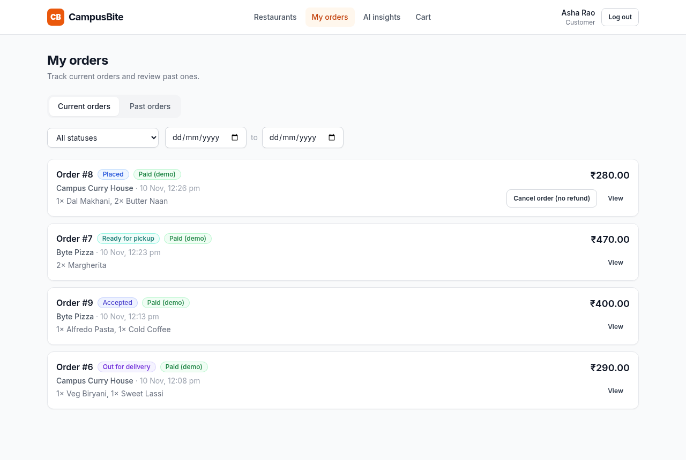<br>**My orders** — current/past tabs, filters, status & payment badges | 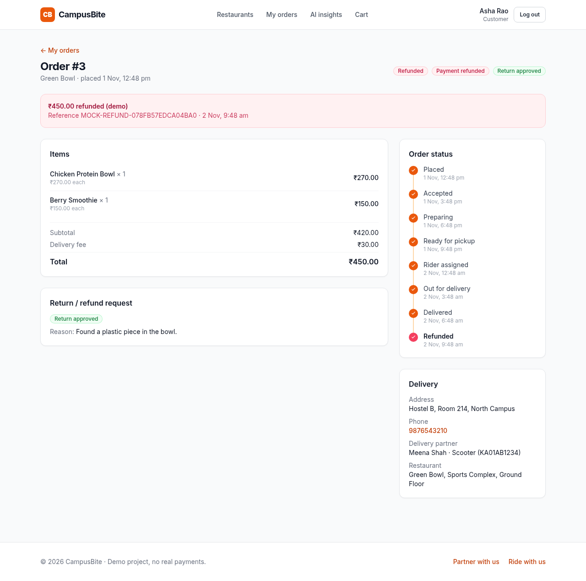<br>**Order details** — timeline, refund record, return status |
| 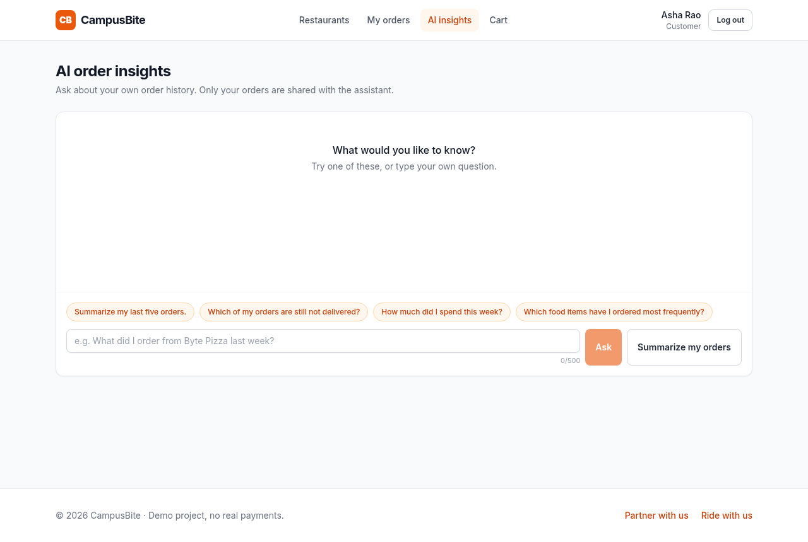<br>**AI order insights** — suggested questions about your own orders | |

### Restaurant owner
| | |
|---|---|
| 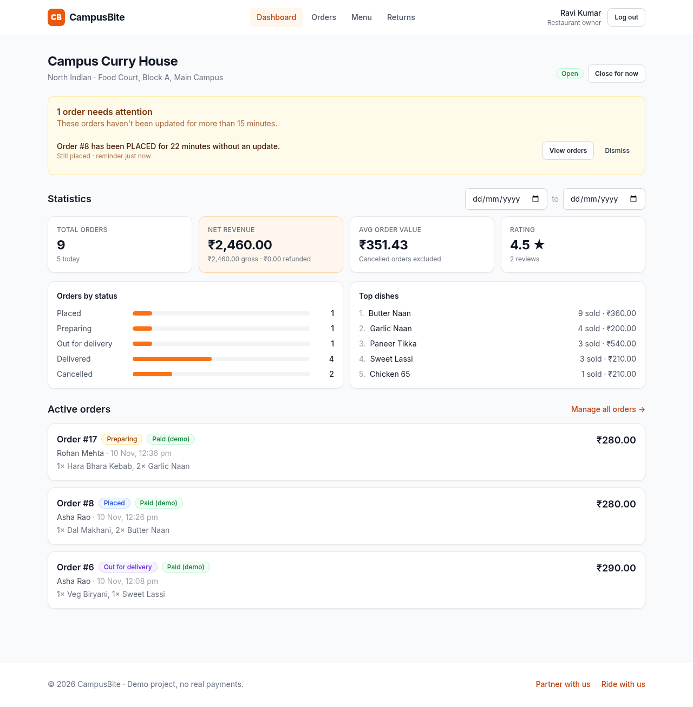<br>**Dashboard** — stale-order reminder, statistics, top dishes, active orders | 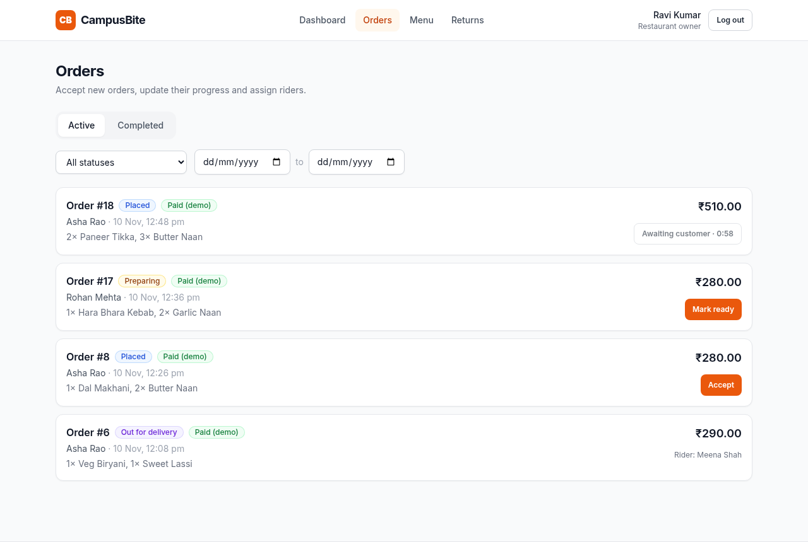<br>**Orders** — Accept blocked during the customer's free window, next-step actions |
| 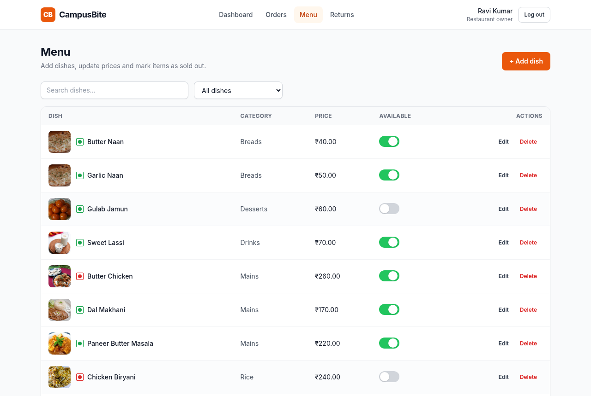<br>**Menu management** — photos, availability switches, edit/delete | 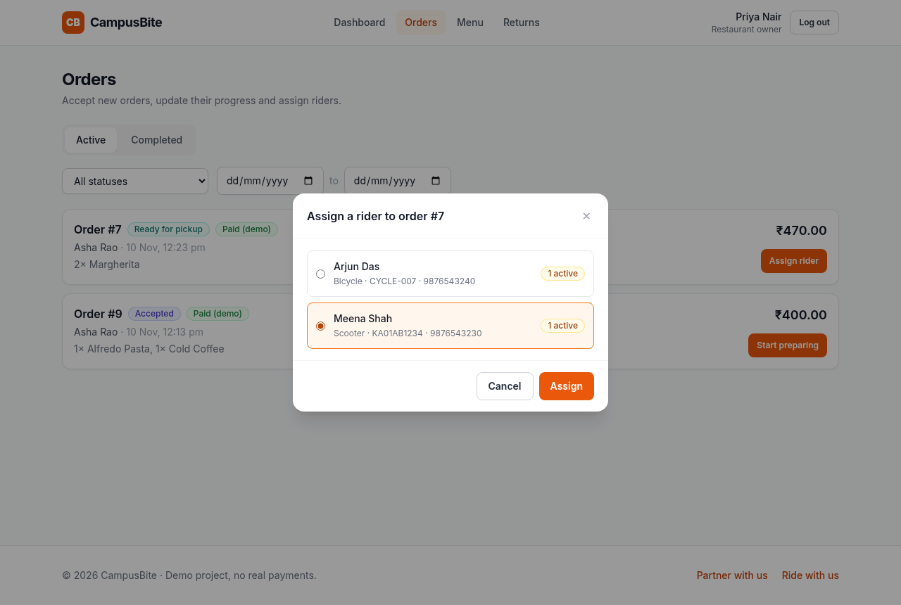<br>**Assign a rider** — partners with their current load |
| 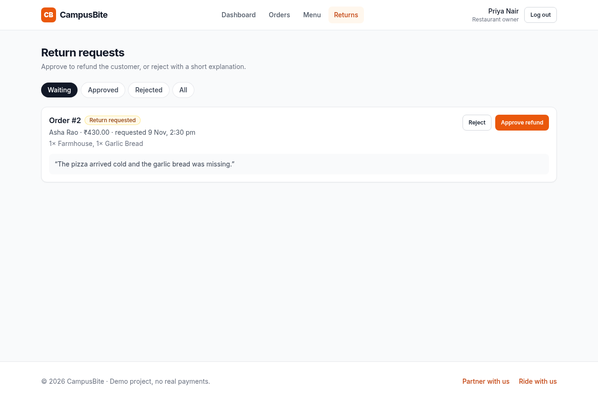<br>**Return requests** — approve (refund) or reject with a note | |

### Delivery partner & mobile
| | | |
|---|---|---|
| 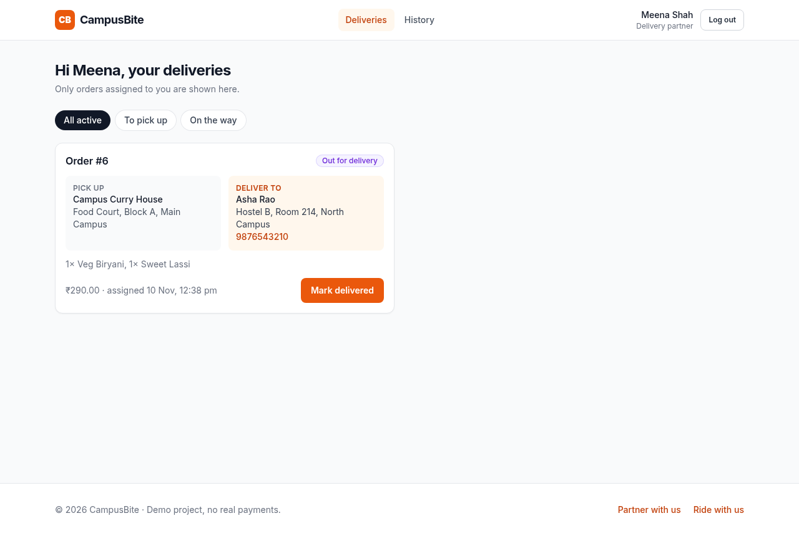<br>**Rider** — only assigned orders, pick-up and customer details | 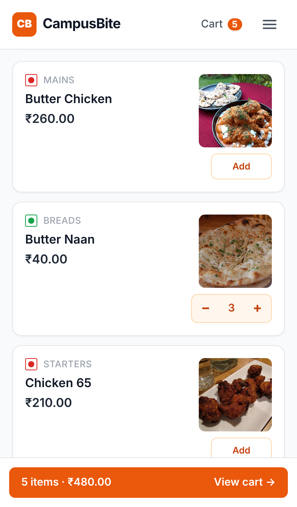<br>**Mobile** — menu with photos | 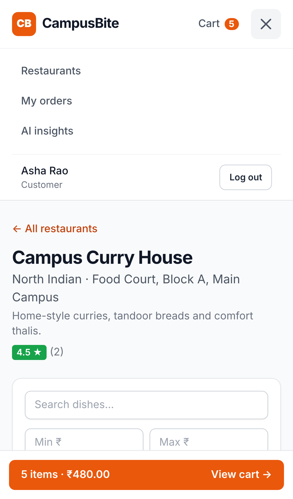<br>**Mobile** — menu drawer and sticky cart bar |

---

## Architecture

```
┌────────────────────┐   REST/JSON + JWT   ┌──────────────────────────┐   SQLAlchemy   ┌──────────────┐
│ React SPA (Vite)   │ ──────────────────▶ │ FastAPI backend (Docker) │ ─────────────▶ │ PostgreSQL   │
│ Router · Context   │ ◀────────────────── │ Auth/RBAC · state machine│                │ (Docker)     │
│ Axios · Tailwind   │                     │ Middleware · reminders   │   HTTPS        ┌──────────────┐
└────────────────────┘                     │ AI insights service      │ ─────────────▶ │ OpenAI API   │
   npm run dev :5173                       └──────────────────────────┘                └──────────────┘
                                              docker compose: backend :8000 + db :5432
```

- **Backend layers:**
  - `api/v1/*` holds thin routers
  - `services/*` holds the business logic, including `order_state.py`, the single place that decides which status changes are allowed
  - `models/*` are the SQLAlchemy models
  - `schemas/*` are the Pydantic request and response models
- **Frontend:**
  - `api/*` has one function per endpoint, plus an Axios client that attaches the JWT and logs out on a 401
  - `context/*` holds login, cart and toast state
  - `pages/*` has one folder per role, plus shared `components/*`

---

## Quick start

**Requirements:** Docker (Docker Desktop or Docker Engine with the Compose plugin) for the backend and database, and Node.js 20 LTS (18+ works) for the frontend.

On Windows, install and verify the prerequisites in PowerShell:

```powershell
docker --version
winget install --id OpenJS.NodeJS.LTS --exact
```

After Node.js finishes installing, reopen PowerShell and verify Node.js and npm:

```powershell
node -v
npm -v
```

### 1. Backend + database (Docker Compose)

```bash
git clone <this-repo-url> campusbite && cd campusbite
cp .env.example .env
# Edit .env: set POSTGRES_PASSWORD and JWT_SECRET_KEY, and OPENAI_API_KEY for AI insights
docker compose up --build
```

On start, the backend container:
1. waits for PostgreSQL
2. applies the migrations (`alembic upgrade head`)
3. loads the demo data if `SEED_DEMO_DATA=true`
4. starts the API

| URL | |
|---|---|
| http://localhost:8000/api/v1/health | Health check → `{"status":"ok","db":"ok"}` |
| http://localhost:8000/docs | Swagger UI (interactive) |
| http://localhost:8000/redoc | ReDoc |

<details>
<summary>Troubleshooting Docker</summary>

| Problem | Fix |
|---|---|
| `Cannot connect to the Docker daemon` | Start Docker. Docker Desktop on Linux: `systemctl --user start docker-desktop`; Docker Engine: `sudo systemctl start docker` |
| `port is already allocated` on 5432 | A local PostgreSQL already uses it: set `POSTGRES_PORT=5433` in `.env`. This only changes the host port; the backend still reaches the database on 5432 inside Docker |
| `port is already allocated` on 8000 | Stop the other server on 8000, or set `BACKEND_PORT=8001`. Then also point `frontend/.env` at the new port and add it to `CORS_ORIGINS` if needed |
| `password authentication failed` | The password changed after the first run: `docker compose down -v`, then `up` again (this deletes the demo data) |
</details>

### 2. Frontend (runs locally)

```bash
cd frontend
cp .env.example .env          # VITE_API_BASE_URL=http://localhost:8000/api/v1
npm install
npm run dev                   # → http://localhost:5173
```

Log in with one of the [demo accounts](#demo-accounts), or sign up as a new user.

<details>
<summary>Running the backend without Docker</summary>

```bash
cd backend
python3.12 -m venv venv && source venv/bin/activate
pip install -r requirements-dev.txt
cp .env.example .env          # point DATABASE_URL at a running PostgreSQL (or use sqlite:///./campusbite.db)
alembic upgrade head
python -m scripts.seed        # optional demo data
uvicorn app.main:app --reload --port 8000
```
</details>

---

## Environment variables

Copy the example files and fill in real values. **Never commit `.env` files** (they are git-ignored, and `.dockerignore` keeps them out of the image).

### Root `.env` (used by Docker Compose)

| Variable | Required | Example / default | Purpose |
|---|---|---|---|
| `POSTGRES_USER` | ✅ | `campusbite` | Database user |
| `POSTGRES_PASSWORD` | ✅ | *(choose one)* | Database password |
| `POSTGRES_DB` | ✅ | `campusbite` | Database name |
| `POSTGRES_PORT` | | `5432` | Host port for PostgreSQL |
| `BACKEND_PORT` | | `8000` | Host port for the API |
| `JWT_SECRET_KEY` | ✅ | *(long random string)* | Signs login tokens. Generate one with `python -c "import secrets; print(secrets.token_urlsafe(48))"` |
| `JWT_ALGORITHM` | | `HS256` | |
| `ACCESS_TOKEN_EXPIRE_MINUTES` | | `60` | How long a login lasts |
| `OPENAI_API_KEY` | for AI | *(your key)* | Without it, `/ai/insights` returns 503 and the rest of the app still works |
| `OPENAI_MODEL` | | `gpt-4o-mini` | |
| `AI_RATE_LIMIT_PER_MINUTE` | | `10` | AI requests allowed per customer per minute |
| `REMINDER_THRESHOLD_MINUTES` | | `15` | When an un-updated order gets a reminder |
| `REMINDER_CHECK_INTERVAL_SECONDS` | | `60` | How often the background task checks |
| `CANCEL_GRACE_SECONDS` | | `60` | Length of the free-cancellation window |
| `DELIVERY_FEE` | | `30` | Flat delivery fee (₹) |
| `CORS_ORIGINS` | | `http://localhost:5173` | Frontend URL(s), comma-separated |
| `SEED_DEMO_DATA` | | `true` | Load demo data on start (only the first time) |
| `LOG_LEVEL` | | `INFO` | |

Compose builds `DATABASE_URL` for the backend automatically. `backend/.env.example` has the same variables plus `DATABASE_URL`, for running without Docker.

### `frontend/.env`
| Variable | Example |
|---|---|
| `VITE_API_BASE_URL` | `http://localhost:8000/api/v1` |

---

## Database setup

- **Engine:** PostgreSQL 16 runs in Docker Compose, with its data in the `pgdata` volume.
- **Schema:** the tables are defined as SQLAlchemy models and versioned with **Alembic** (`backend/alembic/versions/`). Migrations run automatically when the container starts.
- **Restaurant photos:** Docker Compose stores uploaded photos in the persistent `uploads` volume; the backend serves them from `/uploads/`. Crop positioning is stored with the restaurant profile and applied to public restaurant listings.
- **Tables:**
  - `users`, `restaurants`, `menu_items`
  - `orders`, `order_items`, `order_status_history`
  - `reviews`, `payment_ledger`, `return_requests`, `admin_reminder_logs`
- **Key rules enforced by the database:**
  - email is unique
  - one restaurant per owner
  - one review and one return request per order
  - price above 0, quantity 1–20, rating 1–5
- **Relationships:**
  - a customer has many orders
  - a restaurant has many menu items and orders
  - an order has many items, status history rows and payment ledger entries
  - a delivered order can have one review
  - a delivery partner can be assigned many orders

| Task | Command |
|---|---|
| Apply migrations manually | `docker compose exec backend alembic upgrade head` |
| Create a migration after changing models | `docker compose exec backend alembic revision --autogenerate -m "describe change"` |
| Load demo data manually | `docker compose exec backend python -m scripts.seed` |
| Reset everything (deletes all data) | `docker compose down -v && docker compose up --build` |
| Open a psql shell | `docker compose exec db psql -U campusbite -d campusbite` |

---

## Demo accounts

These accounts are created by the seed script (local demo data only). The password for all of them is **`Demo@1234`**.

| Role | Email | What you'll see |
|---|---|---|
| Customer | `demo.customer@campusbite.dev` | 12 orders covering every status: active, delivered, cancelled, refunded, and one with a pending return |
| Customer | `demo.customer2@campusbite.dev` | A few delivered and reviewed orders |
| Owner | `owner.curry@campusbite.dev` | **Campus Curry House**: active orders and a stale-order reminder |
| Owner | `owner.pizza@campusbite.dev` | **Byte Pizza**: a pending return request and a reminder |
| Owner | `owner.green@campusbite.dev` | **Green Bowl** |
| Delivery partner | `rider.one@campusbite.dev` | An order out for delivery, plus history |
| Delivery partner | `rider.two@campusbite.dev` | An order waiting for pickup, plus history |

---

## API documentation

Interactive documentation is generated automatically at **`/docs`** (Swagger) and **`/redoc`**. In Swagger, click **Authorize** and paste the `access_token` from `/auth/login`.

Base path: `/api/v1`. Lists are paginated with `?page=&page_size=` (max 50) and return `{items, total, page, page_size, pages}`. Errors look like `{"detail": "message"}`.

| Method | Path | Who | Description |
|---|---|---|---|
| GET | `/health` | public | Liveness check + DB ping |
| POST | `/auth/register` | public | Customer signup |
| POST | `/auth/register/restaurant-owner` | public | Owner + restaurant signup |
| POST | `/auth/register/delivery-partner` | public | Delivery partner signup |
| POST | `/auth/login` | public | Login (all roles) → JWT |
| GET | `/auth/me` | any | Current user |
| GET | `/restaurants` | public | List restaurants (`search`, `cuisine`) with ratings |
| GET | `/restaurants/{id}` | public | Restaurant details |
| GET | `/restaurants/{id}/menu` | public | Menu with `search`, `min_price`, `max_price`, `category`, `veg`, `sort` |
| GET | `/restaurants/{id}/categories` | public | Menu categories |
| GET | `/restaurants/{id}/reviews` | public | Reviews |
| GET | `/menu-items/{id}` | public | Dish details |
| POST | `/orders` | customer | Place an order (dummy payment) |
| GET | `/orders/me` | customer | My orders (`status`, `scope=active\|past`, `date_from`, `date_to`) |
| GET | `/orders/{id}` | customer / owner / partner | Order details (only the parties to that order) |
| POST | `/orders/{id}/cancel` | customer | Cancel while PLACED (refund if within the free window) |
| POST | `/orders/{id}/review` | customer | Rate a delivered order |
| POST | `/orders/{id}/return` | customer | Request a return/refund (reason required) |
| GET / PUT | `/owner/restaurant` | owner | View or update own restaurant (incl. open/closed) |
| PUT | `/owner/restaurant/image` | owner | Upload a JPEG, PNG, or WebP restaurant photo (multipart `file`, max 5 MB) |
| GET / POST | `/owner/menu-items` | owner | List (incl. unavailable) / add dishes |
| PUT / DELETE | `/owner/menu-items/{id}` | owner | Update / delete (soft) a dish |
| PATCH | `/owner/menu-items/{id}/availability` | owner | Available / unavailable |
| GET | `/owner/orders` | owner | Incoming orders (`status`, `scope`, `date_from`, `date_to`) |
| PATCH | `/owner/orders/{id}/status` | owner | ACCEPTED → PREPARING → READY |
| GET | `/owner/delivery-partners` | owner | Partners with current load |
| POST | `/owner/orders/{id}/assign` | owner | Assign a partner to a READY order |
| GET | `/owner/stats` | owner | Restaurant statistics (`date_from`, `date_to`) |
| GET | `/owner/reminders` | owner | Stale-order reminders |
| PATCH | `/owner/reminders/{id}/acknowledge` | owner | Dismiss a reminder |
| GET | `/owner/returns` | owner | Return requests (`status`) |
| POST | `/owner/returns/{id}/approve` | owner | Approve → refund recorded, order REFUNDED |
| POST | `/owner/returns/{id}/reject` | owner | Reject with a note |
| GET | `/delivery/orders` | partner | My active deliveries (`status`) |
| GET | `/delivery/orders/{id}` | partner | Delivery details incl. customer contact |
| PATCH | `/delivery/orders/{id}/status` | partner | OUT_FOR_DELIVERY → DELIVERED |
| GET | `/delivery/history` | partner | Completed deliveries |
| POST | `/ai/insights` | customer | AI answer about my own orders (`question` optional) |

**Status codes used:**
- `200`, `201`, `204` for success
- `400` invalid business input (e.g. a dish is unavailable)
- `401` not logged in
- `403` wrong role
- `404` not found, or not yours
- `409` invalid state change or duplicate
- `422` validation error
- `429` AI rate limit
- `503` AI unavailable

---

## Order lifecycle and business rules

```
PLACED ──▶ ACCEPTED ──▶ PREPARING ──▶ READY ──▶ ASSIGNED ──▶ OUT_FOR_DELIVERY ──▶ DELIVERED ──▶ REFUNDED
  │  (owner, after the    (owner)       (owner)   (owner assigns   (assigned partner)  (partner)    (owner approves
  │   free window)                                 a partner)                                     a return)
  └──▶ CANCELLED (customer only, while PLACED)
```

- **Status rules:** every status change goes through one table on the backend. Any other change gets **409** (e.g. PLACED → READY, or cancelling a delivered order).
- **Free cancellation (1 minute):**
  - after paying, the customer has `CANCEL_GRACE_SECONDS` (60s) to cancel for a **full automatic refund**, with no reason and no owner involvement
  - the restaurant **cannot accept** the order during that window
  - after the window, the customer can still cancel while the order is PLACED, but **without a refund**
- **Owners cannot reject or cancel orders.** Their only action on a new order is Accept.
- **Refunds after delivery** only happen through a return request. The customer must give a reason (10–500 characters), there is one request per order, and the owner approves or rejects it.
  - Approving: payment → `refunded`, a REFUND ledger entry is written, and the order → `REFUNDED`.
  - Rejecting: the request is marked `rejected` with the owner's note.
- **Reviews** are only allowed on DELIVERED orders, one per order.
- **Prices** always come from the database at checkout. Prices sent by the browser are ignored.
- **Reminders:** a background worker (every 60s, plus an on-demand scan when the owner opens the dashboard) flags orders stuck in PLACED or ACCEPTED for more than 15 minutes. A reminder clears automatically when the order moves on.

---

## Running tests

```bash
# Backend: 228 tests (SQLite in memory, OpenAI mocked)
cd backend && pip install -r requirements-dev.txt && pytest

# Frontend: 58 unit/component tests
cd frontend && npm test

# Frontend live end-to-end UI test: real pages + real API, all three roles
#   1) start a fresh backend on :8000 with a short cancel window, e.g. CANCEL_GRACE_SECONDS=2
#   2) cd frontend && LIVE_API=1 npx vitest run src/test/live
```

For a manual, click-through check of every feature (138 steps with expected results, organised by role, plus 5 regression checks), use **[doc/UI_TEST_PLAN.md](doc/UI_TEST_PLAN.md)**.

The whole plan, plus 37 edge cases, is also automated with Playwright ([doc/ui-test-run/](doc/ui-test-run/)). It was run on SQLite and on Docker Compose with PostgreSQL. The results, the 8 bugs it found (all fixed) and how to re-run it are in **[doc/UI_TEST_REPORT.md](doc/UI_TEST_REPORT.md)**.

The backend tests cover:
- signup, login and token handling
- role and ownership checks (other users' orders → 404)
- every allowed and forbidden status change, and the 1-minute window (with a frozen clock)
- checkout pricing, payments, refunds, reviews and returns
- statistics and reminders (including the background worker)
- AI data isolation, retries and rate limiting
- the seed data, and the migration matching the models

---

## Security

- **Passwords** are hashed with **bcrypt** (cost 12). Login gives the same error for a wrong email and a wrong password.
- **JWT** (HS256, 60-minute expiry). The frontend stores it in `localStorage` and sends it as `Authorization: Bearer …`.
- **Checks on the server:** the user's role is always read from the database, never trusted from the token alone. Each role's routes are protected as a group. Other people's orders, dishes and return requests return **404**, so their existence is never revealed.
- **AI data isolation:** the customer is identified only from their login token. The AI sees only that customer's own orders, and the request cannot include another customer's id.
- **Secrets** live only in environment variables:
  - `.env` is git-ignored and excluded from the Docker image
  - the `.env.example` files contain placeholders only
  - the container runs as a non-root user
- **Input validation:** every request is validated by Pydantic, and unknown fields on write requests are rejected. Search text is escaped so `%` and `_` are treated literally.

---

## Project structure

```
campusbite/
├── docker-compose.yml · .env.example · .gitignore · README.md
├── PLAN.md · TODO.md · doc/ (one design + as-built document per phase) · CLAUDE.md
├── backend/
│   ├── Dockerfile · .dockerignore · requirements*.txt · .env.example · alembic.ini
│   ├── alembic/versions/            database migrations
│   ├── scripts/                     entrypoint.sh · wait_for_db.py · seed.py
│   ├── app/
│   │   ├── main.py                  app factory, middleware, lifespan (reminder worker)
│   │   ├── core/                    config, security (bcrypt/JWT), logging
│   │   ├── db/                      Base, session, UTC datetime type
│   │   ├── models/                  10 SQLAlchemy models + enums
│   │   ├── schemas/                 Pydantic request/response models
│   │   ├── services/                business logic (orders, payments, returns, stats, reminders, AI, …)
│   │   ├── api/                     deps (auth/RBAC) + v1 routers
│   │   ├── middleware/              request logging & timing
│   │   └── workers/                 reminder background worker
│   └── tests/                       pytest suite
└── frontend/
    ├── package.json · vite.config.js · tailwind.config.js · .env.example
    └── src/
        ├── api/ · context/ · hooks/ · utils/
        ├── components/ (common, layout, routing, auth, restaurant, order, owner, delivery)
        ├── pages/ (auth, customer, owner, delivery, OrderDetailPage)
        └── test/ (unit tests + live end-to-end suite)
```

---

## Known limitations

- **Payments are simulated.** No payment gateway is called, and card details never leave the browser.
- **The AI rate limiter and the reminder worker run in memory**, so they assume a single backend instance (fine for this project). Multiple instances would need Redis or a job queue.
- **Order tracking polls** every 15–60 seconds instead of using WebSockets. The PRD does not require real-time updates.
- **Partner accounts are active immediately.** Zomato and Swiggy verify partners first, but this project has no admin role.
